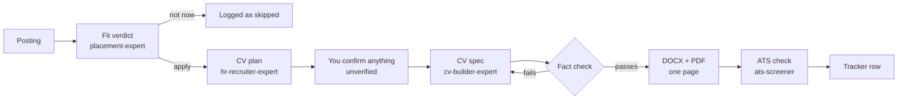

# cv-tailor

A Claude Code plugin that tailors your CV to a job posting without letting it say anything you
can't defend in an interview. It judges the fit first, builds a one-page ATS-safe CV in Hebrew or
English only from claims you've marked as true and explainable, checks it the way an applicant
tracking system would, renders the PDF, and logs the application in your own private tracker.

> **בעברית:** פלאגין ל-Claude Code שמתאים קורות חיים למשרה מסוימת: קודם פסק דין אם בכלל
> כדאי להגיש, ואז קו״ח של עמוד אחד, בעברית או באנגלית, שבנוי רק מטענות שסימנתם כנכונות
> וכאלה שתוכלו להסביר בראיון. בסוף יש בדיקת ATS, קובץ PDF ושורה בלוח ההגשות הפרטי שלכם.
> עברית ב-Word נבדקה כאן ברינדור אמיתי, כולל מספרים, סוגריים ושורות מעורבות.
> **[מדריך התקנה בעברית, צעד אחר צעד](INSTALL.he.md)**

## Why this exists

I built the first version for my own job search: a set of Claude Code agents that read a posting,
told me whether to apply, and wrote the CV. It saved hours. It also made mistakes I only caught
because I read every line before sending:

- It put a project on my CV that I couldn't actually explain, along with tool names that belonged
  to the code my AI assistant had written, not to me.
- It wrote "3+ years" when the dates said two years and nine months, and kept a job as "present"
  after it had ended.
- It split one system into two projects to fill space.
- It built CVs before anyone had asked whether the job was worth applying to.
- Its Hebrew Word files looked fine in a preview and came out scrambled in Word: numbers on the
  wrong side, brackets mirrored.

Each of these is now a rule the plugin enforces in code, not a sentence in a prompt it might
ignore. This version is rebuilt so anyone can use it with their own profile.

## How it works



The order is fixed. A CV is never built before the verdict, and nothing is written to disk until
the fact check passes.

### What the fact check blocks

| Mistake | How it's caught |
|---|---|
| A claim you marked `do-not-use`, or one you haven't confirmed | Every bullet cites its source item in your profile; the status is checked |
| A skill you can't claim, slipped into the summary | Free text is scanned for the names of blocked skills |
| A number that isn't in the source ("cut time by 6 hours" when you wrote 4) | Every number must appear in the bullet's source |
| "2+ years" when the dates say 1 year 10 months | Durations are computed from your start and end dates, never rounded up |
| A degree in progress written as completed | Phrases like "holds a degree" are blocked while the degree is in progress |
| One item presented as two, or a claim moved to another employer | Each source can be used once, and only under its own job |
| Job titles, employers or dates that drifted | They never pass through the AI at all; the generator reads them from your profile |

## Install

Requirements: [Claude Code](https://claude.com/claude-code), Python 3.9+, and for PDF rendering
Microsoft Word on Windows or macOS (LibreOffice works as a fallback, but it can hide Hebrew
layout problems that Word shows).

```bash
python -m pip install python-docx pyyaml docx2pdf pymupdf
```

In Claude Code:

```
/plugin marketplace add galsalman/cv-tailor
/plugin install cv-tailor@cv-tailor
```

To try it from a local clone instead: `claude --plugin-dir path/to/cv-tailor`.

## Use

Make an empty folder for your job search, open Claude Code in it, and run:

| Command | Does |
|---|---|
| `/cv-tailor:cv-setup [your-cv.docx]` | Builds your `profile.yaml` (from an existing CV or by interview), reviews every claim with you, creates your tracker |
| `/cv-tailor:tailor-cv <posting URL, file or text>` | The full pipeline above, for one posting |
| `/cv-tailor:track [what happened]` | "submitted to Acme", "Acme interview on 2026-11-03", or no argument to see what's in flight |
| `/cv-tailor:scan-setup` | Windows: sets up the automatic job scan and its schedule (`stop` removes it) |
| `/cv-tailor:scan` | Runs one job scan now |

On a Windows computer that stays on, `/cv-tailor:scan-setup` also schedules an **automatic
job scan**. It runs twice a day by default and searches Drushim, AllJobs and JobMaster with
terms built from your profile. It judges each new posting the way the fit-verdict agent does,
and adds the best few to your tracker as "scan suggestions". You mark each one "Track" or "Not
relevant", and a dismissed posting is never offered again. LinkedIn is off by default because
its terms forbid automated collection. `/cv-tailor:scan` runs a scan once by hand. In the
scheduled runs, Claude Code runs headless from the Windows Task Scheduler, with a 25-minute cap
and a dry-run switch.

Two more agents are there when you ask for them: **reconnect-advisor** (should I follow up with
a company that went quiet, and what do I write) and **personal-branding-expert** (is a LinkedIn
rewrite or a portfolio site worth the time this week).

## Your profile

`profile.yaml` is the only source the CV builder may use. Every bullet, skill and project
carries two flags:

| `status` | `explainable` | What the builder does |
|---|---|---|
| `verified` | `true` | Uses it |
| `verified` | `false` | Asks you first |
| `self-reported` | either | Asks you first, never includes it silently |
| `do-not-use` | either | Never uses it, whatever the posting asks for |

When you import an existing CV, everything starts as `self-reported` and you confirm items one by
one. See [`examples/dana-levi/profile.yaml`](examples/dana-levi/profile.yaml) for a filled-in
profile of a fictional person, built to trip every check, and
[`templates/profile.template.yaml`](templates/profile.template.yaml) for the blank one.

## Your tracker

Each user gets their own empty tracker; no one's rows are shared.

- **On claude.ai** (when your Claude Code session has the Artifact tools): a private dashboard
  page with live statuses you can change from your phone.
- **Locally** otherwise: `tracker/dashboard.html` in your job-search folder, opened in any
  browser, updated by the commands.

Both count days since you applied and mark a job "no reply" after 10 days without an answer.

## Hebrew

Hebrew CVs are built with python-docx and checked in Word itself, because other viewers hide
Word's bidi bugs. The rules in [`skills/hebrew-docx/SKILL.md`](skills/hebrew-docx/SKILL.md) were
found by rendering labeled variants side by side and reading them, and they correct the commonly
published advice in places. Some patterns still break in Word no matter what the code does (a
comma right after an English word before Hebrew, brackets around a number); the fact check warns
about them and the builder rewords them.

## Layout

```
agents/          six agents: verdict, plan, builder, ATS, follow-up, personal branding
commands/        /cv-setup, /tailor-cv, /track, /scan, /scan-setup
skills/
  cv-render/     fact check, DOCX builder, PDF render, ATS extraction
  hebrew-docx/   Hebrew/English bidi rules and helpers for Word
scanner/         job-site collector and the Windows scheduled-task scripts
dashboard/       tracker page (claude.ai or local) and the local tracker script
templates/       blank profile
examples/        fictional profile used for testing
```

## Limits

- Tested on Windows with Word. macOS should work through docx2pdf but hasn't been tested.
- A duration in the summary ("3+ years") is checked against your total experience, not against
  one specific role.
- Pages behind a login (often LinkedIn) can't be fetched; paste the posting text instead.
- The CV layout is single-column on purpose. Two-column designs look better to a human and
  often get scrambled by applicant tracking systems.

## License

[MIT](LICENSE).

## Credits

The Hebrew DOCX rules started from the
[`hebrew-document-generator`](https://github.com/skills-il) skill by skills-il (MIT), narrowed to
Word and corrected after testing.
